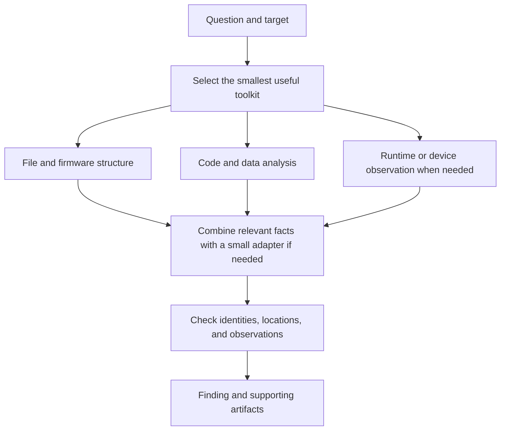

# AIRevEngMatrix

AIRevEngMatrix is a reverse engineering skill and reference library for investigating software and firmware. It helps turn a concrete question into a small analysis toolkit, then a finding that can be checked against the original bytes or an observed run.

A question might be: what does this function do, which program starts this device's network service, what changed between two releases, or which responses identify a particular implementation? The toolkit depends on the question. Reading an executable's imports may need one parser. Explaining a device's update process may need an image extractor, a disassembler, and a capture from the device.

The repository supplies selection guidance, analysis procedures, adapter specifications, and result checks. Analysis engines are separate dependencies. There is no bundled server, mandatory tool stack, or prebuilt collection of executable adapters.

## How an investigation works

1. **Define the result.** Identify the question, target, and evidence needed to answer it.
2. **Choose the tools.** Check which installed tools understand the format, processor, runtime, or device involved.
3. **Collect the relevant facts.** Read structure and code, extract components, or observe a bounded run. A small script or adapter connects tools when their outputs need joining.
4. **Check the finding.** Verify important offsets, identities, call sites, or observations against the source. Record unresolved steps.
5. **Deliver the result.** Return the explanation, extracted files, comparison, or verification report with enough detail to reproduce the decisive checks.

These branches are choices. A file-format question can finish without a debugger or device. Graphs and evidence bundles become useful when a finding spans several components or needs to be transferred and audited.

## What can be analyzed

| Target family | Typical questions | Results |
| --- | --- | --- |
| Native executables and libraries | What does a function do? How does an input reach an API? Which imports, resources, or protections are present? | Binary layout, disassembly, decompiler interpretation, call references, type and dispatch candidates |
| Apple applications | Which executable and resources make up the app? How is a UI action connected to code? What does the signature cover? | Bundle inventory, resources, entitlements, Objective-C/Swift metadata, supported UI-to-code links |
| .NET and Android applications | Which methods implement a feature? Where are native boundaries? Is acquisition of an installed app complete? | Assembly or DEX structure, decoded resources, method traces, APK/split inventory, device observations |
| JavaScript, Electron, and websites | Which module handles an action? What crosses an IPC boundary? Which source is recoverable? | Module and handler relationships, source locations, captured scripts, browser scenarios and traffic |
| Embedded Linux, MCU/RTOS, and UEFI firmware | What is in the image? How does it boot? Which service is exposed? How are updates checked? | Region and partition maps, extracted files, boot paths, task/interrupt analysis, update and trust-path findings |
| Processes, protocols, and crashes | What happened during a run? How are messages framed? Which signals are remotely visible? | Process effects, crash state, message sequences, fingerprint candidates with tested conditions |
| EVM bytecode | Which dispatch branches, selectors, events, and storage accesses are visible? | Instruction-anchored interface candidates and unresolved ABI details |
| Custom formats, WebAssembly, JVM, Python, and Go | How is a record encoded? Which runtime method implements a feature? Which host/native boundaries matter? | Checked format parsers, runtime-specific instructions/interfaces, recovered metadata, and unresolved dependencies |
| Flash chips, debug interfaces, and hardware buses | Are the acquired bytes consistent? What does a transaction mean? Does a model reproduce the device's response? | Verified dumps, decoded captures, minimal firmware experiments, and model limitations |
| Parsers and stateful services under test | Which input reaches a branch or produces a failure? Which bytes influence a result? | Bounded test harnesses, replayable failures, concrete path witnesses, and input-dependency explanations |
| System memory and recorded executions | What state existed at capture time? Which earlier event caused the observed fault? | Located runtime artifacts, checked extractions, and replay-based event explanations |
| Releases and reconstructions | What changed? Does a replacement reproduce the required behavior? | Matched and unmatched changes; passing, failing, missing, and incomparable cases |

The [capability matrix](references/capability-index.md) maps individual questions to methods, outputs, and checks. The [operation catalogue](references/operation-catalog.md) lists the individual analysis primitives behind those results, with inputs, outputs, and validation requirements.

## Tool taxonomy

Tools have different roles. A **parser** reads a file's structure; a **disassembler** decodes instructions; a **decompiler** proposes higher-level code; a **debugger or tracer** records execution; an **emulator** runs code against a modeled environment. An **adapter** is the small amount of glue needed to select inputs, invoke an engine, preserve locations, and return a usable result.

The tools below are candidates described by the methods. Inclusion does not mean they are bundled, installed, interchangeable, or supported for every target. Libraries and CLIs can be used directly; a new adapter is useful only when the requested result needs one.

This taxonomy groups engines and interfaces by role. For individual operations such as function inspection, browser execution coverage, device package installation, or evidence revision, the [operation catalogue](references/operation-catalog.md) provides the more detailed specification. Related operations share a row where their implementation and checks are similar. Documented scope and verified executable behavior are separate properties.

### Decompilers by language and shipped representation

Choose an engine for the bytes actually shipped: native instructions, managed bytecode, VM instructions, or source text. The language used to display pseudocode does not establish the original source language. Optimized native code usually loses names, types, and source constructs that no decompiler can recover exactly.

The [development-environment workflows](references/development-environments.md) provide detailed procedures for the major compiler/runtime ecosystems. Each covers artifact intake, named recovery efforts, language-specific constructs, verification and deliverables. The language names below link to those workflows.

| Language or representation | Decompilers and supporting tools | What can be recovered; main limits |
| --- | --- | --- |
| **Rust native code** | **Oxidizer/angr**, Ghidra, IDA/Hex-Rays with Rust analysis support, Binary Ninja; `rustc-demangle`/`rustfilt` for names | Oxidizer provides Rust-specific reconstruction and has merged into angr's main branch; verify the installed revision. Binary Ninja's Pseudo Rust is an output representation. Trait objects, enums, generics, drop paths, and async lowering need instruction checks. See the [Rust workflow](references/rust-reverse-engineering.md). |
| [C and C++](references/cpp-reverse-engineering.md) | Ghidra, Hex-Rays, Binary Ninja, radare2 with r2ghidra, Rizin with rz-ghidra, RetDec, Hopper, JEB | Native pseudocode, types and dispatch candidates; MSVC/GCC/Clang ABI, edition and maintenance status govern the choice |
| [Swift and Objective-C](references/apple-reverse-engineering.md) | Native decompiler, DSDump, Swift demangler and Apple tools | Classes, selectors, protocols, witness tables and code relationships; optimized Swift needs ABI-aware interpretation |
| [Go](references/go-reverse-engineering.md) | Native decompiler, GoReSym, GoRE/Redress | Runtime/function/type metadata and native behavior, including interfaces, defer and goroutine boundaries |
| Zig, D, Nim, Fortran, Ada | Compatible native decompiler plus compiler/runtime metadata | Native behavior and surviving symbols; language-specific source reconstruction may be unavailable |
| [Haskell, OCaml, native Lisp and COBOL](references/specialized-development-environments.md) | Compatible native/VM analyzer with exact compiler/runtime metadata | Closures, tagged/packed values, calling conventions and runtime behavior where supported |
| [Julia, R and scientific environments](references/specialized-development-environments.md) | Matching runtime introspection, IR/native views and captured code maps | Selected specialization, bytecode or numerical behavior; loading/compilation can execute code |
| [Pascal, Delphi and legacy p-code](references/specialized-development-environments.md) | Native/VM decompiler; IDR for its supported Delphi targets | Forms, types, runtime relationships and supported pseudocode; VB6 p-code differs from VB.NET CIL |
| [C#, F#, VB.NET and CLR languages](references/dotnet-reverse-engineering.md) | ILSpy, dnSpyEx, dotPeek, CIL/metadata readers | Managed reconstruction, generated state machines and resources; Native AOT needs a separate native route |
| [Java, Kotlin, Scala and JVM languages](references/jvm-android-reverse-engineering.md) | Vineflower and compatible language plugins, CFR, class/bytecode readers | Supported Java/Kotlin-oriented reconstruction, generated methods and metadata; plugin/version support is explicit |
| [Android DEX](references/jvm-android-reverse-engineering.md) | JADX, JEB; Apktool for resources and smali | DEX methods, resources and JNI relationships; minified/desugared builds need matched bytecode checks |
| [Python](references/python-reverse-engineering.md) | PyLingual, pycdc, uncompyle6, decompyle3, xdis, pyinstxtractor-ng | Supported source reconstruction, versioned disassembly and package extraction have separate support ranges |
| [Lua, LuaJIT and Luau](references/interpreter-reverse-engineering.md) | unluac, LuaDec, LJD, Unluau and matching VM tools | Source or instructions for compatible variants; LJD/Unluau maturity and unsupported constructs are explicit |
| [Dart and Flutter AOT](references/mobile-game-reverse-engineering.md) | Blutter plus a native decompiler | Supported Dart metadata and native instructions; Blutter's documented target route is Android ARM64 |
| [Unity Mono/IL2CPP](references/mobile-game-reverse-engineering.md) | ILSpy/dnSpyEx, Cpp2IL, Il2CppDumper and native decompiler | Paired metadata/code and asset links; generated stubs can lack recovered method bodies |
| [Unreal and Godot](references/mobile-game-reverse-engineering.md) | CUE4Parse/FModel, KismetKompiler, GDRE Tools, native/managed engines | Supported resources, Blueprint/GDScript and code relationships; engine/version coverage differs across tools |
| [JavaScript and TypeScript](references/javascript-reverse-engineering.md) | AST/source-map tools, Wakaru, hermes-dec, View8 | Shipped source or supported HBC/V8 reconstruction; exact bytecode/cache compatibility governs selection |
| [Erlang, Elixir and BEAM languages](references/interpreter-reverse-engineering.md) | `beam_lib`, compatible BEAM disassembly/debug-info tools | Abstract forms when retained, otherwise VM instructions; original Elixir/Erlang source is not guaranteed |
| ActionScript | JPEXS FFDec | Supported SWF/ABC instructions, resources, and decompiled ActionScript |
| [WebAssembly](references/wasm-reverse-engineering.md) | WABT `wasm-decompile`, wasm-tools | Wasm-oriented pseudocode, instructions, component and host interfaces; original source is not implied |
| [Solidity/Vyper/Yul and EVM](references/specialized-development-environments.md) | Heimdall-rs and fork-compatible EVM analysis | Candidate interface/control flow with explicit storage, proxy and state context |
| eBPF, GPU and shader code | bpftool/LLVM, NVIDIA binary utilities, SPIRV-Tools | Instructions, interfaces and selected higher-level interpretations; each ISA, IR version and host binding needs its own route |
| [Ruby YARV and PHP opcodes](references/interpreter-reverse-engineering.md) | Matching ISeq/Zend inspection, VLD and native/runtime tools | Supported instructions and semantics; the guide records where a source decompiler is unavailable |

The [language guide](references/language-decompilation.md) supplies engine selection and checks. The [VM guide](references/virtual-machines.md) covers packaged bytecode, snapshots, paired metadata, and custom instruction sets. GhidRust is documented as a paused, unreliable legacy option, not the default Rust route. Engine maturity and version support are recorded in the relevant method.

### Files, code, and application packages

| Tool class | Candidate tools or interfaces | Role and main limits | Method |
| --- | --- | --- | --- |
| Identification and extraction | Header readers, hash libraries, ZIP/TAR/CPIO readers, format-specific extractors | Identify bytes and recover members; preserve original names and extraction provenance | [Artifacts](references/native-and-artifacts.md) |
| Executable structure | LIEF, pyelftools, pefile, macholib, LLVM tools | Read ELF, PE, or Mach-O structure as supported; file offsets and memory addresses have different meanings | [Native layout](references/native-and-artifacts.md) |
| Native disassembly and decompilation | Ghidra, IDA/Hex-Rays, Binary Ninja, angr, Hopper, radare2 with r2ghidra, Rizin with rz-ghidra, RetDec, JEB | Recover instructions, references, functions, and higher-level interpretations; processor, edition, plugin, and maintenance support govern selection | [Language selection](references/language-decompilation.md), [native code](references/native-and-artifacts.md) |
| Apple resources and metadata | `plutil`, `ibtool`, `assetutil`, `codesign`, `otool` | Inspect bundles, resources, signing, and loader metadata; availability and output vary with the Apple toolchain | [Apple applications](references/native-and-artifacts.md) |
| .NET metadata and CIL | dnfile, dnlib, System.Reflection.Metadata, ILSpy, `ildasm` | Read assemblies and intermediate language; Native AOT code follows the native-analysis path | [Managed code](references/managed-mobile-firmware.md) |
| Android packages and resources | `aapt2`, `apkanalyzer`, Apktool, JADX, JEB | Decode package metadata, resources, DEX, smali, or decompiled code; split packages and native libraries need explicit coverage | [Android packages](references/managed-mobile-firmware.md) |
| JavaScript syntax and modules | Babel, Acorn, SWC, TypeScript AST APIs | Parse syntax and trace imports, handlers, and calls; dynamic loading and computed names may remain unresolved | [JavaScript](references/javascript-and-web.md) |
| Electron packaging and source recovery | `@electron/asar`, source-map libraries, formatters, Wakaru | Read shipped modules and recover readable representations; missing external members or original sources remain gaps | [Electron and sources](references/javascript-and-web.md) |
| EVM decoding | Strict hex/bytecode decoder, EVM disassembler or analysis engine | Identify dispatch, event, and storage patterns; an inferred selector label does not establish a full ABI | [EVM](references/native-and-artifacts.md) |
| Custom binary formats | Kaitai Struct | Describe a layout and generate a parser; bounds, malformed inputs, and unknown fields need explicit checks | [Format recovery](references/formats-and-runtimes.md) |
| WebAssembly | wasm-tools, WABT | Validate and inspect modules, components, instructions and interfaces; WABT includes Wasm pseudocode output | [Wasm](references/formats-and-runtimes.md), [languages](references/language-decompilation.md) |
| JVM classes and archives | Vineflower, CFR, bytecode inspection | Reconstruct readable Java and explain class/method relationships; descriptors and runtime variants preserve identity | [JVM](references/formats-and-runtimes.md) |
| Python bytecode | xdis, PyLingual, pycdc, uncompyle6, decompyle3, pyinstxtractor-ng where applicable | Inspect code objects or reconstruct supported source; extraction, disassembly and decompilation have separate support | [Python](references/python-reverse-engineering.md) |
| Go metadata | GoReSym, GoRE/Redress with a native analyzer | Recover available metadata and inspect language/runtime behavior | [Go](references/go-reverse-engineering.md) |

### Firmware and hardware

| Tool class | Candidate tools or interfaces | Role and main limits | Method |
| --- | --- | --- | --- |
| Region discovery | Binwalk, Unblob, bounded signature and entropy scans | Locate candidate embedded formats; important hits need parser validation | [Image identification](references/firmware.md) |
| Filesystem and container recovery | Unblob, SquashFS, UBI/UBIFS, JFFS2, ext and CPIO tools | Recover components and files with metadata; flash geometry, compression, and logical extents affect mapping | [Extraction](references/firmware.md) |
| Boot and update metadata | U-Boot/FIT tools, `dtc`/libfdt, partition parsers, Android OTA and logical-partition parsers | Read image selection, hardware description, load addresses, update operations, and slot relationships; delta updates may require an exact base image | [Boot and updates](references/firmware.md) |
| UEFI and PC firmware | UEFITool/UEFIExtract, firmware-volume and PE/COFF parsers, CHIPSEC | Inspect volumes, modules, variables, and platform state; static parsing and privileged hardware operations have different requirements | [UEFI](references/firmware.md) |
| Emulation and device observation | QEMU, Renode, Qiling, serial capture, OpenOCD with a compatible probe, GDB | Observe a process, supported machine, or physical target; record peripheral models, OS dependencies, substitutions and reset | [Runtime observation](references/firmware.md), [firmware experiments](references/firmware-lab.md) |
| Flash and MCU acquisition | flashrom, pyOCD | Read supported chips or debug memory with an identified programmer/probe; check repeated bytes, address coverage and attach effects | [Acquisition](references/firmware-lab.md) |
| Hardware signals | sigrok, PulseView, sigrok-cli | Acquire and decode supported instrument captures; preserve raw samples, pin mapping and decoder settings | [Signals](references/firmware-lab.md) |
| Hardware execution trace | CoreSight capture interfaces, compatible probes, OpenCSD | Decode supported trace streams and correlate them with exact code images; trace source, packet version, synchronization and loss determine coverage | [Hardware trace](references/firmware-specializations.md) |
| CAN interpretation | cantools | Read supported databases and decode/encode frames; validate field meaning against independently known device states | [CAN](references/firmware-lab.md) |
| Register maps and RTOS structures | CMSIS-SVD parsers, matching RTOS symbols/types, native analyzer | Annotate peripheral accesses, tasks and handlers with exact part/build provenance | [Register and RTOS analysis](references/firmware-specializations.md) |
| Flash filesystems and platform tables | MTD utilities, UBIReader, Jefferson, ACPICA tools | Decode geometry-qualified flash images, JFFS2/UBIFS, or ACPI AML; physical/logical offsets and live acquisition differ | [Specialized firmware](references/firmware-specializations.md) |
| USB, Bluetooth and RF | USBPcap, usbmon, btmon, Wireshark, GNU Radio, inspectrum | Interpret captured transactions or samples; host-controller capture is not complete over-the-air or physical-bus visibility | [Device protocols](references/firmware-specializations.md) |
| FPGA, PLC and physical measurements | Yosys, Verilator, exact vendor/runtime tools, ChipWhisperer | Analyze supported HDL/netlists, controller artifacts, or controlled measurements; arbitrary FPGA bitstreams and PLC binaries need family-specific decoders | [Specialist targets](references/firmware-specializations.md) |

### Runtime, traffic, and comparison

| Tool class | Candidate tools or interfaces | Role and main limits | Method |
| --- | --- | --- | --- |
| Native debugging, tracing, and crashes | GDB, LLDB, WinDbg, Frida, platform tracing and accessibility APIs | Inspect state, calls, crash dumps, or UI observations; correct modules and symbols are essential | [Native runtime](references/native-and-artifacts.md) |
| Android device access | ADB | Inventory a selected device and acquire apps, files, logs, or screenshots; device state and permissions determine access | [Device operations](references/managed-mobile-firmware.md) |
| Browser and Node/Electron observation | Chrome DevTools Protocol, V8 Inspector, Electron DevTools | Capture loaded scripts and events within an attach window; target and domain coverage constrain conclusions | [Runtime capture](references/javascript-and-web.md) |
| Browser scenarios | Playwright or an equivalent action harness | Replay interactions and assert outcomes with controlled browser settings | [Scenarios](references/javascript-and-web.md) |
| Advertised browser tools | Experimental WebMCP interface, when exposed by the selected browser | Discover advertised names and schemas; browser/version support and invocation permissions are separate | [Discovery](references/javascript-and-web.md) |
| Traffic and protocol analysis | Wireshark/TShark, PCAP/PCAPNG parsers, HAR/CDP logs, mitmproxy captures | Reassemble and compare messages; missing packets, encryption, proxies, and capture gaps limit attribution | [Protocols](references/process-and-reconstruction.md), [web traffic](references/javascript-and-web.md) |
| Process scenarios | Host process APIs, PTY/ConPTY, Windows Job Objects where needed | Record input, output, exit state, and selected effects; a capture harness does not itself isolate a program | [Processes](references/process-and-reconstruction.md) |
| Differences and reconstruction | Digest/member manifests, instruction/AST/CIL comparators, image diffs, scenario comparators | Align matching inputs and compare structure or behavior; similarity and passing examples have a bounded scope | [Comparison](references/process-and-reconstruction.md) |
| Evidence and navigation | Small JSON adapters, bounded graph queries, digest-checked bundles, optional obligation ledgers | Preserve supporting records and unresolved questions for larger investigations | [Evidence](references/evidence-and-runtime.md) |
| Process and kernel events | strace, ltrace, perf, bpftrace, drgn, crash, ETW/WPR/WPA, Procmon, DTrace, Instruments | Locate calls, state and events on supported hosts; symbols, capture loss and instrumentation affect interpretation | [Platform tracing](references/platform-and-kernel.md) |
| eBPF, GPU and shader programs | bpftool, LLVM, cuobjdump, nvdisasm, SPIRV-Tools | Inspect separate source IR, translated, and device/JIT representations with maps or bindings | [Platform code](references/platform-and-kernel.md) |
| Protocol grammars and schemas | Scapy, Wireshark/TShark, Kaitai Struct, protoc, flatc, matching ASN.1/CBOR/MessagePack readers | Recover framing, fields and state or apply a matched schema; serialization consistency alone does not establish field meaning | [Protocol methods](references/protocol-and-data-formats.md) |
| Unpacking, rewriting and instruction experiments | Detect It Easy, YARA, UPX, Capstone, Keystone, LIEF, LLVM, Unicorn | Identify transformations, rebuild a copy, or run bounded instruction snippets; preserve original bytes and check ABI, relocation and integrity effects | [Binary transformations](references/binary-transformations.md) |

### Testing, matching, and runtime artifacts

A **fuzzer** generates varied inputs and records outcomes. **Symbolic execution** represents selected inputs as variables and solves conditions on their paths. **Taint analysis** tracks input influence under a defined policy. Each needs a target-specific environment and concrete checks. A **software inventory** identifies components; a **memory analyzer** recovers structures from captured runtime state.

| Tool class | Candidate tools or interfaces | Role and main limits | Method |
| --- | --- | --- | --- |
| Coverage-guided testing | AFL++ with compatible source or binary instrumentation | Explore a selected input boundary; requires a checked harness, reset and failure oracle | [Fuzzing](references/testing-and-constraints.md) |
| Protocol testing | boofuzz | Mutate structured exchanges with session/reset/monitor logic; message delivery does not measure code coverage | [Protocol campaigns](references/testing-and-constraints.md) |
| Symbolic paths and input influence | angr, Triton | Find constrained inputs or instruction-level dependencies; replay witnesses and record model assumptions | [Constraints and taint](references/testing-and-constraints.md) |
| Function matching | Diaphora with compatible IDA exports | Match functions across builds and inspect changes; retain heuristic, ambiguous, and unmatched outcomes | [Matching](references/matching-and-runtime-artifacts.md) |
| Component inventory | Syft | Produce an inventory/SBOM from supported filesystems, archives, or images; stripped/static components may remain unidentified | [Inventory](references/matching-and-runtime-artifacts.md) |
| Capability and string discovery | capa, FLOSS | Find located behavior candidates or decoded strings; confirm decisive leads in code or observations | [Discovery](references/matching-and-runtime-artifacts.md) |
| System memory | Volatility 3 | Extract selected runtime structures from supported captures; acquisition, symbols and address layers determine coverage | [Memory](references/matching-and-runtime-artifacts.md) |
| Execution recording and replay | rr | Debug a recorded execution on a supported Linux host; one schedule does not cover every possible run | [Replay](references/matching-and-runtime-artifacts.md) |

An installed engine still needs the right version, architecture support, license where applicable, and accessible API or CLI. Hardware observation also needs the actual device and compatible interfaces. The [assembly guide](references/assembly-patterns.md) describes these selection decisions.

## Example toolkits

| Question | Small starting toolkit | Deliverable |
| --- | --- | --- |
| Which libraries does this PE import? | Hash plus PE parser | Import list with source offsets and parsing limitations |
| Which program starts the web service in this firmware? | Image extractor plus init/config inspection; disassembler if startup remains unclear | Startup chain, executable/config paths, and supported listener candidates |
| What does this MCU interrupt handler do? | Memory map plus one compatible disassembler | Handler explanation with vector entry, memory accesses, and uncertain hardware behavior |
| Where does this Electron button write a file? | ASAR/member reader, JS parser, selected runtime capture when needed | UI-to-IPC-to-filesystem path with evidence at each boundary |
| Can this service be identified remotely? | Existing captures or bounded authorized probes, protocol decoder, comparison controls | Observable signals, preconditions, stability, and attribution limits |
| Does a replacement preserve the required behavior? | Original fixtures, process or browser harness, focused comparator | Results for each required case and explicit gaps |
| Can this firmware handler reproduce a captured reply? | Identified image, compatible Renode/Qiling environment, one captured input | Small experiment, checked reply, model assumptions and differences |
| Which parser input causes this failure? | Baseline fixture, AFL++ harness, concrete replay | Original/minimized input, failure classification and repeatable reproduction |
| What is this CAN signal measuring? | Raw capture, cantools database, independently known device states | Checked field interpretation with frame references and remaining uncertainty |
| What does this stripped Rust function return? | Compatible native analyzer, Rust-aware decompilation where supported, demangler/metadata, small behavior fixture | Instruction-checked result/error paths, type and dispatch hypotheses, and unrecovered details |
| What does this Flutter or Unity package contain? | Package inventory, matching runtime metadata parser, native decompiler | Metadata-to-code links with paired-build identities and unavailable method bodies |

## Reusable templates

The [template guide](references/templates.md) links copyable working records and explains their fields. A record captures the inputs, method, expected result, and checks for an actual investigation. YAML records are specifications and observation records; they do not execute tools. Unknown values remain explicit until measured.

| Work | Templates |
| --- | --- |
| Select a small toolkit and deliver a finding | [Toolkit plan](assets/templates/toolkit-plan.yaml), [finding](assets/templates/finding.md) |
| Triage, acquire firmware, and run controlled experiments | [Firmware triage](assets/templates/firmware-triage.yaml), [acquisition](assets/templates/acquisition.yaml), [firmware experiment](assets/templates/firmware-experiment.yaml) |
| Reconstruct an embedded Linux boot chain or an update policy | [Boot chain](assets/templates/boot-chain.yaml), [update policy](assets/templates/update-policy.yaml) |
| Decode physical signals or CAN frames | [Bus decoding](assets/templates/bus-decoding.yaml) |
| Test inputs and explain path conditions | [Fuzz campaign](assets/templates/fuzz-campaign.yaml), [path query](assets/templates/path-query.yaml), [test cases](assets/templates/test-cases.csv) |
| Recover a format or inspect another runtime | [Format study](assets/templates/format-study.yaml), [runtime study](assets/templates/runtime-study.yaml) |
| Compare builds, inventory components, or inspect runtime state | [Comparison/inventory](assets/templates/comparison-inventory.yaml), [memory/replay](assets/templates/memory-replay.yaml) |
| Build a small declarative parser | [Synthetic Kaitai schema](assets/templates/framed-record.ksy), [positive and negative fixtures](assets/templates/framed-record-fixtures.yaml) |
| Select a decompiler or inspect a VM | [Decompilation study](assets/templates/decompilation-study.yaml), [VM study](assets/templates/virtual-machine-study.yaml) |
| Assess an entire compiler/runtime route | [Environment study](assets/templates/environment-study.yaml), [source fixtures and build profiles](references/environment-fixtures.md) |
| Trace a platform or analyze specialist hardware | [Platform trace](assets/templates/platform-trace.yaml), [hardware scope](assets/templates/hardware-scope.yaml) |
| Unpack, rebuild, or recover a protocol | [Binary transformation](assets/templates/binary-transformation.yaml), [protocol study](assets/templates/protocol-study.yaml) |
| Assess required and missing coverage | [Coverage assessment](assets/templates/coverage-assessment.yaml) |

The Kaitai example is a complete synthetic format with a fixed header and bounded payload. Its fixtures cover valid records, invalid fields, truncation, and exact-consumption checks. Applying it to a real format requires a recovered layout and checks against that format's samples.

The [Rust fixture](assets/fixtures/rust-patterns.rs) and its [seven behavior cases](assets/fixtures/rust-patterns.yaml) provide known source and outputs for debug and optimized builds. They exercise parsing, checked arithmetic, result variants and trait dispatch. Passing the behavior cases checks the fixture; assessing a decompiler requires checking its output against the selected build's instructions.

The [environment fixtures](references/environment-fixtures.md) add C++, C#, Java, Go, Swift, Python, JavaScript, Dart, Lua and Erlang sources with ten shared behavior cases and compiler-specific profiles. They exercise dispatch, closures, errors, async lowering or cleanup. Additional APK, Flutter, game-engine, Wasm and other SDK profiles have explicit fixture specifications. Baseline compilation/execution and decompiler reconstruction are recorded separately.

The [firmware fixtures](references/firmware-fixtures.md) add a synthetic uImage header with valid, bad-payload-CRC, truncated and bad-magic cases, and a Cortex-M vector-table image with a single consistent load base. They check a header parser's CRC branches and load-base inference against known answers, keeping the fixture check separate from a result on a real image.

## Use and repository guide

The repository root is a skill directory. It can be installed under the name `reverse-engineer-direct` in a compatible host's skills directory, or used as a reference library. An investigation needs a concrete question and the relevant artifact, capture, or accessible target. Tool installation and device access depend on the execution environment.

| File | Purpose |
| --- | --- |
| [SKILL.md](SKILL.md) | Skill entrypoint and routing |
| [Capability matrix](references/capability-index.md) | Analysis questions, expected results, and checks |
| [Operation catalogue](references/operation-catalog.md) | Individual operation selectors, inputs, outputs, and validation requirements |
| [Toolkit assembly](references/assembly-patterns.md) | Tool selection and adapter design |
| [Native artifacts](references/native-and-artifacts.md) | Native code, Apple bundles, crashes, and EVM |
| [JavaScript and web](references/javascript-and-web.md) | Shipped source, Electron, browser capture, and scenarios |
| [Managed code and mobile devices](references/managed-mobile-firmware.md) | .NET, Android packages, ADB, and JEB |
| [Firmware](references/firmware.md) | Image recovery, embedded Linux, MCU/RTOS, UEFI, boot, and updates |
| [Firmware triage](references/firmware-triage.md) | Signature, architecture, and load-base tables with falsification checks |
| [Embedded Linux services](references/embedded-linux-services.md) | Boot-to-service path: filesystem selection, init families, dispatch, reachability |
| [Firmware lab](references/firmware-lab.md) | Execution models, chip/debug acquisition, signals, and CAN |
| [Firmware fixtures](references/firmware-fixtures.md) | Known-answer uImage header and Cortex-M base-inference checks |
| [Testing and constraints](references/testing-and-constraints.md) | Fuzz harnesses, protocol campaigns, failure replay, symbolic inputs, and taint |
| [Formats and runtimes](references/formats-and-runtimes.md) | Kaitai parsers, Wasm, JVM, Python bytecode, and Go metadata |
| [Matching and runtime artifacts](references/matching-and-runtime-artifacts.md) | Function matching, software inventory, capability/string discovery, memory, and rr |
| [Template guide](references/templates.md) | Copyable experiment specifications, records, fixtures, and findings |
| [Process, protocol, and comparison](references/process-and-reconstruction.md) | Observed behavior, fingerprints, differences, and reconstruction |
| [Graph and evidence conventions](references/evidence-and-runtime.md) | Optional structures for joins, provenance, and audit |
| [Language and decompiler guide](references/language-decompilation.md) | Language families, shipped representations, engines and recovery limits |
| [Development environments](references/development-environments.md) | Detailed environment workflows, named recovery efforts, language lowering, checks and deliverables |
| [Environment fixtures](references/environment-fixtures.md) | Known sources, build profiles, expected cases and SDK-specific assessment requirements |
| [Rust reverse engineering](references/rust-reverse-engineering.md) | Rust-aware engines, traits, enums, generics, async lowering, panic paths and ABI checks |
| [Virtual machines](references/virtual-machines.md) | Python, Lua variants, Dart, IL2CPP, Hermes, BEAM, legacy and custom VMs |
| [Platform and kernel analysis](references/platform-and-kernel.md) | Host tracing, drivers, eBPF, GPU and shader representations |
| [Firmware specializations](references/firmware-specializations.md) | Registers, RTOS, trust boundaries, raw flash, USB, Bluetooth, RF, FPGA, PLC and physical measurements |
| [Binary transformations](references/binary-transformations.md) | Unpacking, assembling, rewriting and bounded instruction emulation |
| [Protocols and data formats](references/protocol-and-data-formats.md) | Framing, schemas, state, replay and remote attribution |
| [Coverage map](references/coverage-map.md) | Required target/method boundaries, documented scope, tested scope and explicit gaps |

## What a result establishes

A useful finding includes the answer, target identity, decisive offsets or observations, key tool versions, and material gaps. New parsers and adapters need a known fixture and a relevant target check; malformed-input checks matter when decoding untrusted structures. The capability matrix specifies checks for each result family.

The [coverage map](references/coverage-map.md) separates documented methods, available engines, checked fixtures, and checked targets. It supplies routes across the major target families and an extension procedure for an unsupported compiler, architecture, format, or device. Catalogue size is not a measure of executable support.

Decompiled code is an interpretation of compiled bytes. A static call path supports code relationships; runtime evidence establishes what happened in a particular run. A firmware component's presence does not establish that it boots or is reachable. A passing reconstruction test establishes agreement only for the tested cases and observations. These distinctions keep the final answer tied to the evidence available.
